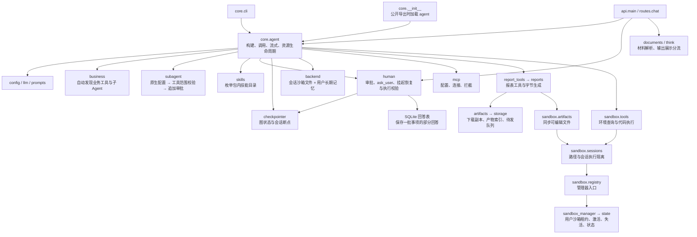
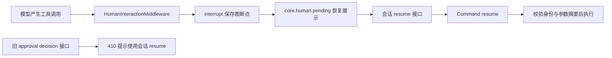
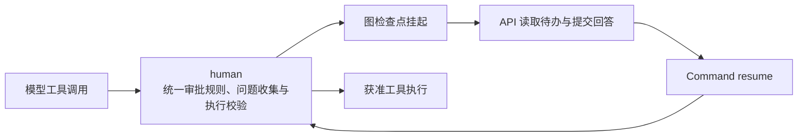

# Core 包架构与精简讨论

更新时间：2026-10-04。本文根据当前源码绘制，区分现有实现与待讨论方案。
旧的 architecture.md 使用 astra_agent 路径，不能据此判断当前实际依赖。

## 可编辑画板：精简目标 v1

- [Excalidraw 源文件](./core-architecture.excalidraw)：在 Excalidraw 中打开，可拖动分组、修改文字与连线。
- [SVG 预览](./core-architecture.svg)：无需启动项目即可查看。

这版画板是讨论后的目标方案，保留沙箱、人工介入、Skills、记忆持久化、普通和流式输出、子 Agent。
审批与 ask_user 共用挂起恢复流程；子 Agent 优先使用原生配置，减少重复转换。
下文仍记录重构前的现状，不能将目标画板理解为已经完成的代码改动。

## 1. 当前架构（第一批重构后）

箭头表示主要调用或依赖关系，分组用于阅读，不代表建议新增对应目录。

公共支撑：context_type 提供调用身份，core.sessions 校验会话归属，security 与 utils.logging 处理脱敏及日志。

运行时上下文使用 `MemoryContext(user_id, tenant_id, project_id, roles, permissions, extra, request_token)`：
`user_id` 必填，其余身份字段默认空；权限显式传入，`can()` 只检查 permissions。
`request_token` 默认空字符串，不进入模型默认打印和 `model_dump()`，不自动转发 MCP。
HTTP 入口从 Bearer Authorization 提取 token；目前尚未验证凭证，不代表已完成鉴权。
入口支持 X-Tenant-Id / X-Project-Id / X-User-Roles，兼容旧 X-Org-Id / X-User-Role；
未提供租户头仍使用 default-org，以保留现有沙箱和记忆的访问路径。
沙箱继续按租户与用户复用，长期记忆与人工介入额外区分 project_id。
现有会话历史归属仍按 user_id 校验，完整租户及项目级会话鉴权需单独完善。

### HTTP 返回契约

普通 JSON 接口统一返回 `{"code":"0","message":"成功","data":...}`。
`api/responses.py` 定义 `ApiResult[T]`、`ResultCode` 和异常处理；路由显式返回
`success(data)` 并绑定响应类型，OpenAPI 与实际返回保持一致，不在中间件中读取或拼接响应体。
成功 code 为字符串 `"0"`，错误 code 使用 HTTP 状态码的字符串形式（如 `"401"`、`"422"`、`"500"`）；
HTTP 状态码本身仍保留。校验错误只返回字段位置、错误类型和文案，不回显原始输入；未知异常返回通用文案。
新建会话保持 HTTP 201，删除会话改为 HTTP 200，`data` 为 null。
文件内容、下载重定向、SSE 事件及 OpenAPI 文档不包裹；文件和 SSE 建立前的 HTTP 错误仍返回统一 JSON。
前端 `api.ts` 提供 `readApi` / `unwrapApi` 解包及错误处理，上传 XHR 使用同一规则；
`checkResponse` 仅在 HTTP 失败时读取 JSON，不消耗成功的文件或 SSE 流。
backend 与 storage 的名字相似，但前者是 Deep Agents 文件/记忆后端，后者是下载文件的本地/OSS 存储，不能按名字直接合并。

原生文件工具默认通过 `sandbox/backend.py` 访问 OpenSandbox：运行上下文决定用户沙箱，会话 ID 决定目录。`/`、`/workspace` 映射到当前会话根目录；其他会话路径、路径穿越和越界符号链接被拒绝。框架提供分页读取、搜索与编辑实现，实际命令及二进制传输复用 namespace 隔离，不新增模型可调用的 shell 工具。跨会话文件仍须经过 `import_session_file` 审批导入。`/memories/` 继续路由到用户隔离的 StoreBackend。

## 2. 人工交互统一链路

Agent 工厂只安装 HumanInteractionMiddleware；前端通过会话 resume 接口继续执行。
core.human 统一声明 ask_user、审批规则、执行前校验、待办读取及部分回答保存。
API 只负责 HTTP 输入、SSE 输出，以及将核心异常转换为 404 / 409 / 422。
旧内存审批、独立 questions 工具模块和 api.human 已移除。

## 3. 已确认的问题与调整建议

| 优先级 | 源码证据 | 问题 | 建议 |
|---|---|---|---|
| 第一批（已完成） | human.py、api/routes/interactions.py、api/routes/approvals.py | 持久化挂起与内存等待两套实现并存；审批放行条件重复 | 已统一至 human.py，旧提交接口返回 410；前端继续使用现有 resume 接口 |
| 第二批 | core/__init__.py、agent.py 中延迟导入注释 | 导入核心配置会先触发包入口对 Agent 的加载，增加导入耦合 | 收缩包入口的主动导入，内部使用明确模块路径；核对 CLI、API、测试及外部入口兼容性 |
| 第三批 | config.py 的 InvestmentHTTPConfig、prompts.py 的招商段落 | 通用核心承担单个业务的配置和执行约定 | 把招商配置和指令移回 business/investment，复用现有业务发现机制，避免再造插件框架 |
| 后续 | subagent/base.py、agent.py | 项目 Spec 再转换框架字典，skill_paths 声明未被转换函数消费；工具解析存在多种兜底路径 | 核对实际调用方和框架版本后，仅保留使用中的契约；优先修正缺失工具处理，再决定是否去掉 Spec |
| 后续 | agent.py | 同时承担构建、调用包装、资源启停，run_once 与 stream_once 重复准备上下文 | 先提取少量私有函数消除重复；只有职责继续增长才拆文件，不新增 Manager/Factory 抽象层 |

不把所有复杂度归为过度设计：

- checkpointer 保存对话和断点，backend 访问会话沙箱文件与长期记忆，生命周期不同。
- core.sessions 做会话归属校验；sandbox.sessions 做沙箱内路径及执行隔离，不能互相替代。
- artifacts 保存下载副本与索引；sandbox.artifacts 保存可继续编辑的副本。是否统一存储属于产品语义变更。
- 沙箱租约、状态持久化、用户边界、路径校验和显式跨会话导入应继续保留。
- human.py 的部分回答存储支持一批多个挂起事项，不能仅因有图检查点就直接移除。

## 4. 建议第一批的目标

第一批只解决审批重复，不同时搬迁沙箱、文件存储和业务包。
仓库内前端已使用 resume；旧 decision 接口返回 410，外部消费者如仍使用它需迁移到会话 resume。
公共策略归入现有模块即可，不引入审批引擎、策略注册器或通用工作流基类。

必须保持的行为：刷新后恢复待办、批准/拒绝、自由输入与选项、批量事项部分回答、用户与会话隔离、参数摘要校验、子 Agent 审批、恢复后不重复写操作。
验证需包括全量 pytest、ruff，以及真实服务的挂起/刷新/恢复流程；审批相关测试应迁移到现行链路，不能只删除旧测试来取得通过结果。

## 5. 第一批实施结果与边界

- 已完成：删除 core/approvals.py、core/questions.py、api/human.py；人工交互集中在 core/human.py，生产代码净减少 160 行。
- 保持不变：interrupt 的 kind/items/digest 等字段、human_decisions 状态、SQLite 表结构与路径，兼容现有挂起和部分回答记录。
- 行为变化：旧 POST /approvals/{id}/decision 返回 410；approve 必须为 JSON 布尔值，字符串不再隐式转换。
- 已验证：全量 pytest、ruff；真实 HTTP 服务上的普通输出、SSE、刷新读取、部分回答、恢复与重复提交；真实 Deep Agents 子 Agent 的挂起和恢复。模型使用确定性替身，不调用外部模型。
- 验证限制：PostgreSQL 集成测试因未显式启用 RUN_PG_TESTS 跳过；图重建复用内存检查点的测试不等于验证 PostgreSQL 跨进程重启。
- 并发边界：现有 thread_lock 是单进程锁，本批没有增加分布式互斥；外部写操作在进程崩溃后的幂等性仍需工具或业务系统保证。
- 第二批已实施：子 Agent 改为框架原生配置，删除 base.py 和 registry.py，保留工具范围校验、重复名称拒绝与审批保护。沙箱、Skills、记忆及子 Agent 功能继续保留。

## 6. 子 Agent 精简结果

- 定义：各子 Agent 模块直接导出原生字典，__init__.py 汇总。
- 构建：agent.py 的私有方法 _build_subagents 合并配置、校验名称及工具实例，追加 HumanInteractionMiddleware，再由主流程传给 create_deep_agent。
- 删除：SubAgentSpec、to_deepagents_subagent 和单独注册表；model、skills 等原生字段不再经过项目转换层。
- 边界修正：代码审查的 tools=[] 保持为空，不再变成继承全部业务工具。框架自带的文件工具仍受审批校验。
- 业务契约：业务子 Agent 也使用原生字典，工具引用来自同批注册的 TOOLS；具体说明见 business-plugins.md。
- 验证：全量 pytest 和 ruff；内存中的真实图委派、工具范围、未注册工具及重名拒绝；独立真实 FastAPI 生命周期和 HTTP 委派请求。验证使用模拟模型，未调用外部模型、MCP 或沙箱。

框架恢复语义参考：[LangGraph Interrupts](https://docs.langchain.com/oss/python/langgraph/interrupts)。中断节点恢复时会从头执行，因此人工交互前不执行业务写操作，恢复后继续校验参数和身份。
## 7. 用户沙箱 skills

沙箱首次创建、服务重启后首次连接、以及从挂起恢复时，将 `src/core/skills/` 下含
`SKILL.md` 的技能目录（含脚本和资源）复制到该用户容器的 `/workspace/skills/`。
同名技能完整保留，只补充不存在的技能；初始化失败保留容器并在下次连接重试。
新增内置技能在下次激活时补入，升级已有技能需显式处理，不自动覆盖用户版本。

每个用户有独立副本，同用户会话通过 namespace 只读挂载共享技能库；会话文件仍隔离。
Deep Agents 扫描 `/workspace/skills/` 父目录，通过 Backend 加载技能，而非读取宿主机路径。
框架会缓存会话的技能元数据；旧会话需清空 `skills_metadata` 后重载，新会话自动加载。
